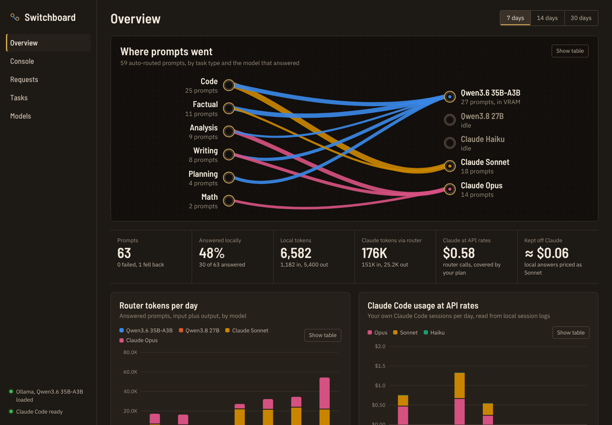
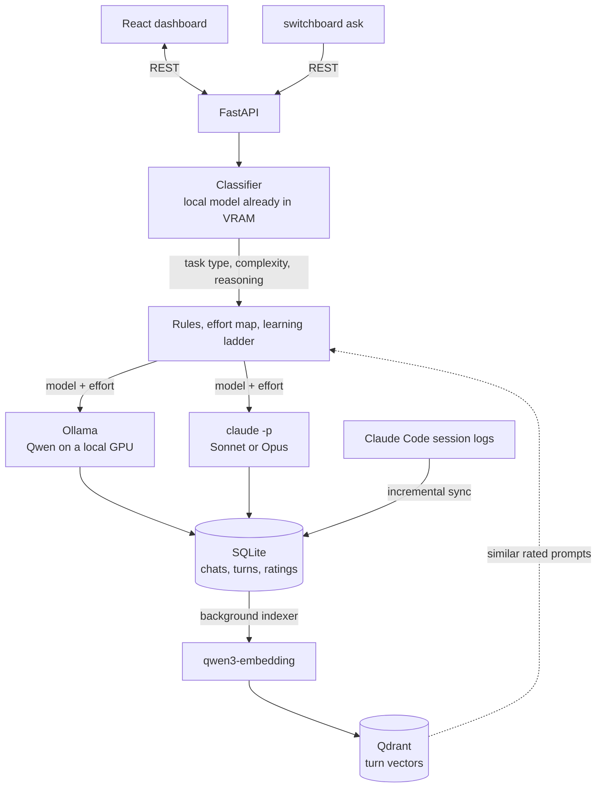

# Switchboard

[](https://github.com/Anders-T-Strand/Switchboard/actions/workflows/ci.yml)

A self-hosted AI console that decides, for every prompt, which model should answer it and how hard that model should think.

Most prompts are answered by a Qwen model running locally through Ollama. The ones that need more go to Claude Sonnet or Opus through Claude Code's headless mode, on a Claude Pro subscription instead of API billing. Every chat is saved and can be picked up later, every turn records why it was routed where it was, and a thumbs up or down on an answer teaches the router which model handles which kind of prompt.



## Highlights

- **Two-axis routing.** A local classifier rates each prompt for complexity (which model) and reasoning (how much thinking) separately, so a prompt can run on Opus at low effort or on Sonnet at extra high.
- **A router that learns from ratings.** New prompts are matched against rated past prompts in a Qdrant vector index. If a model's answers to similar prompts were rated bad, the prompt moves up a model ladder. If a cheaper model's were rated good, it moves down.
- **One chat, several models.** A conversation can move between the local model and Claude, with history passed along in the form each one takes, and follow-ups rated in the context of what they refer to.
- **Hybrid search and memory.** Chat search fuses vector and keyword results with reciprocal rank fusion. Memory pulls related turns from other chats into a new one.
- **Usage you can see.** Tokens, latency and API-equivalent cost per model, plus your own Claude Code sessions read incrementally from its local logs.
- **Tested and checked.** 80 tests run against a fake Ollama, a fake `claude` CLI and Qdrant's in-process mode, on Windows and Linux in CI.

## Architecture



## Design decisions

- **Claude through `claude -p`, not the API.** Routed calls run on an existing Pro login, so they cost nothing extra. The CLI's API key variables are stripped from its environment so a stray key can't switch it to API billing. Cost is still shown at API rates, as a measure of what was used.
- **Built around one GPU.** The classifier runs on whichever local model is already loaded, a loaded model answers instead of swapping in another, and every Ollama call uses the same context size, because Ollama reloads a model when that changes.
- **Complexity and reasoning are separate ratings.** How capable a model needs to be and how long it should think are different questions. Mapping them to model and effort separately keeps strong models from overthinking easy-but-delicate prompts.
- **SQLite is the record, Qdrant is derived.** Vectors can be rebuilt at any time. Each indexed turn records which embedding model made it, so changing models re-indexes, and a missing or resized collection is recreated from SQLite.
- **Learning only acts on explicit ratings.** Copying the classifier's past choices would just reinforce them. Moves need several similar, rated answers, and every move is shown with the prompts and ratings behind it.
- **History is shaped per provider.** Ollama gets earlier turns as chat messages. Claude gets a transcript in its system prompt, which also covers turns another model answered. Both are trimmed oldest first to a per-provider budget.

## Tech stack

Python 3.11+, FastAPI, SQLite, Qdrant, Ollama, Claude Code CLI. React 19, TypeScript, Vite. pytest, ruff and GitHub Actions.

## How routing works

1. **Classify.** A local model reads the prompt and rates it on two separate scales from 1 to 5. Complexity is how capable a model has to be. Reasoning is how much step-by-step thinking the answer needs. It also labels the task type (code, writing, math, analysis...). If Ollama is down, a keyword heuristic takes over so routing never blocks.
2. **Pick a model.** Rules in `config.yaml` are checked top to bottom and the first match wins. By default, complexity 5 goes to Claude Opus, 4 goes to Claude Sonnet, and so does a complexity 3 prompt that needs reasoning 5. Everything else stays local.
3. **Pick an effort.** Reasoning maps to an effort level: 1 and 2 are low, 3 is medium, 4 is high, 5 is extra high. Claude gets it through `CLAUDE_CODE_EFFORT_LEVEL`, which overrides your own `/effort` setting for that call only. Local models get thinking off at low and on above it.
4. **Answer, with fallback.** If the chosen model fails (Ollama offline, not logged in to Claude Code, usage limit hit), the router tries the next model in `fallback_order` at the same effort and records why.

Because the model and the effort are picked separately, they combine the way the prompt needs:

| Prompt | Complexity | Reasoning | Runs on |
|---|---|---|---|
| A wedding speech in a famous writer's style | 5 | 1 | Opus at low |
| Design an exactly-once event pipeline | 5 | 5 | Opus at extra high |
| A race condition across three workers | 4 | 5 | Sonnet at extra high |
| Refactor a function to remove shared state | 4 | 4 | Sonnet at high |
| A 3-week study plan | 3 | 3 | Qwen, thinking on |
| The capital of Norway | 1 | 1 | Qwen, thinking off |

Rules can pin the effort (`effort: high`) or clamp it (`min_effort`, `max_effort`), and a Claude model can have its own `max_effort` cap, for example to keep Opus from using too much of your plan. Picking a model or effort in the Console, or with `--model` and `--effort` on the CLI, overrides the router for that prompt.

If a rule picks a local model that isn't loaded but another one is, the loaded model answers. Turn this off with `prefer_loaded_local: false`.

## Chats

Every prompt belongs to a chat, including ones sent from the terminal, so any earlier question can be picked up again. The Console lists chats newest first, with search over titles and every message.

- **Each turn is routed on its own.** The classifier sees the previous exchange, so a short follow-up like "why?" or "make it shorter" is rated as hard as the work it refers to instead of as trivial.
- **History travels with the model.** Local models get earlier turns as chat messages. Claude gets them as a transcript in its system prompt, which works even when earlier replies came from Qwen. The oldest turns are left out first once a chat outgrows `chat.history_chars`, and the route note says when that happened.
- **Rate answers.** Thumbs up or down on each answer. The ratings are counted per model on the Overview, and the router learns from them (see below).
- **Download the history.** The chat list links to two JSON Lines files: whole chats, and one line per turn with the routing decision, the outcome, the previous prompt and your rating.

Prompts sent before chats existed were turned into one-turn chats the first time the server started, so they can be continued too.

## Vector index (Qdrant)

Every answered turn is embedded through Ollama (`qwen3-embedding:0.6b` by default) and stored in [Qdrant](https://qdrant.tech). SQLite stays the record and Qdrant holds the vectors, so the index can always be rebuilt from SQLite. Each turn is one point with two named vectors: the prompt alone, and the prompt with its answer. A background thread indexes turns as they're saved, catches up on history the first time it runs, and re-indexes everything if you switch embedding model.

The index is used for three things:

- **Search by meaning.** Chat search ranks chats by meaning and by matching words together (reciprocal rank fusion), so "that vacuum thing in Postgres" finds the autovacuum chat.
- **A router that learns from your ratings.** Each new prompt is compared with past prompts. If the routed model's answers to similar prompts were mostly rated bad (at least `min_votes` of them), the prompt moves up `routing.learn.ladder`, for example from Qwen to Sonnet. If a cheaper model's answers to similar prompts were rated good and none bad, it moves down. "How it was routed" lists the closest past prompts with their ratings, and the answer is tagged when ratings changed the route. It only acts on ratings, so it does nothing until you rate some answers.
- **Memory.** Turn on Memory for a chat in the Console, and each message brings up to four related turns from your other chats into the system prompt, for local models and Claude alike. The answer is tagged with how many it used, and "How it was routed" links to them.

### Running Qdrant

```powershell
ollama pull qwen3-embedding:0.6b
```

Then pick one:

- **Docker Desktop (easiest).** `.\switchboard` starts a `switchboard-qdrant` container when Qdrant isn't already running, storing data in a named Docker volume. Qdrant warns that mounting a Windows folder can lose data, which the named volume avoids. It only listens on 127.0.0.1, since Qdrant has no login by default. To run it yourself: `docker run -d --name switchboard-qdrant --restart unless-stopped -p 127.0.0.1:6333:6333 -v switchboard_qdrant:/qdrant/storage qdrant/qdrant`
- **Native Windows build.** Download `qdrant-x86_64-pc-windows-msvc.zip` from [Qdrant's releases](https://github.com/qdrant/qdrant/releases), unzip it and run `qdrant.exe`. It listens on port 6333 and keeps its data in a `storage` folder next to it.
- **No server.** In `config.yaml`, remove `index.qdrant.url` and set `index.qdrant.path: data/qdrant`. The Qdrant client then stores everything in that folder itself. Fine for one person, slower than the server.

To look inside, open http://localhost:6333/dashboard. Each point's id is the request id in SQLite, and its payload holds the model, effort, task type, complexity, reasoning and the start of the prompt. Full text and ratings stay in SQLite.

The sidebar shows how many turns are indexed. Without Qdrant or the embedding model, everything else keeps working and search falls back to matching words. The Models page shows the index status and has a button to re-index everything.

The embedding model is small (about 640 MB) and stays loaded next to your chat model.

## What it tracks

- **Chats and router requests.** Prompt, answer, classification, rule, model, effort, context sent along, tokens, latency, fallbacks and your rating, stored in SQLite.
- **Claude Code usage.** Your own Claude Code sessions are read from `~/.claude/projects/**/*.jsonl` every minute, so the dashboard shows usage by model and day even for work done outside it. Calls the router makes through `claude -p` are tagged separately. Chats on claude.ai don't write local logs, so they can't be counted.
- **Cost at API rates.** A Pro plan isn't billed per token, so costs are shown as what the same usage would cost on the Claude API. Local answers are priced against a reference model (Sonnet by default) to estimate what running locally kept off Claude. Local and Claude tokenizers differ, so treat that one as a ballpark.
- **Tasks.** A simple to do / in progress / done board. Attach prompts to a task to see how many tokens each piece of work takes.

## Requirements

- Windows 10/11, macOS or Linux
- Python 3.11 or newer
- Node.js 22 LTS (only to build the dashboard)
- [Ollama](https://ollama.com) with at least one model pulled
- [Claude Code](https://code.claude.com), installed and logged in with your Claude account

## Setup on Windows

```powershell
git clone https://github.com/Anders-T-Strand/Switchboard.git
cd Switchboard

# Pull the local models named in config.yaml (or edit config.yaml to match what you have)
ollama pull qwen3.6:35b-a3b

# Make sure Claude Code works headless on your login
claude -p "say hi"

# Start it. The first run sets up Python and builds the dashboard.
.\switchboard
```

The dashboard opens in your browser at http://127.0.0.1:8787. You can also double-click `switchboard.cmd` in Explorer, or make a shortcut to it and pin that to the taskbar.

After the first run it just starts the server. It rebuilds the dashboard on its own when you pull changes.

To start it from any folder, add this to your PowerShell profile (`notepad $PROFILE`) with your own path:

```powershell
function switchboard { & "C:\path\to\Switchboard\switchboard.cmd" @args }
```

If the sidebar says Claude Code wasn't found, run `where.exe claude` in PowerShell. The server also checks `%USERPROFILE%\.local\bin` and `%APPDATA%\npm`, so a fresh install is usually picked up after a restart. Otherwise set `claude.command` in `config.yaml` to the full path of `claude.exe`.

## Setup on macOS and Linux

```bash
git clone https://github.com/Anders-T-Strand/Switchboard.git
cd Switchboard
ollama pull qwen3.6:35b-a3b        # or edit config.yaml to match your models
ollama pull qwen3-embedding:0.6b
./start.sh --open
```

`start.sh` does the same as the Windows launcher: it sets up Python, builds the dashboard when needed, starts Qdrant in Docker if it isn't running, and opens the dashboard.

### Manual setup

```powershell
cd backend
py -3 -m venv .venv
.venv\Scripts\activate
pip install -r requirements.txt

cd ..\frontend
npm install
npm run build

cd ..\backend
python -m switchboard
```

## Using it from the terminal

With the server running:

```powershell
cd backend
python -m switchboard ask "Why does my PyTorch DataLoader hang on Windows?"
python -m switchboard ask --model claude-opus "Review this design: ..."
python -m switchboard ask --effort low "Summarize this changelog: ..."
Get-Content notes.txt | python -m switchboard ask -
python -m switchboard ask --task 3 "Draft the intro paragraph"
python -m switchboard ask --chat last "And how would that change on Linux?"
```

The routing decision, token counts and chat id print to stderr and the answer to stdout, so the answer can be piped somewhere else. `--chat` takes a chat id or `last` to continue a conversation.

## Configuration

Everything lives in `config.yaml`. Restart the server after editing it.

| Section | What it controls |
|---|---|
| `models` | Every model the router can use. `provider` is `ollama` or `claude_cli`. For Claude, `model` is the alias passed to `claude --model` and `max_effort` caps its effort. For Ollama, `think` pins thinking on or off. |
| `routing.rules` | Ordered rules. Conditions: `task_types`, `min_complexity`, `max_complexity`, `min_reasoning`, `max_reasoning`. Effort: `effort` to pin it, `min_effort` and `max_effort` to clamp it. |
| `index` | Qdrant location, collection, embedding model and how much text per turn gets embedded. `enabled: false` turns the vector index off. |
| `routing.learn` | The model ladder for learning from ratings, how many similar prompts to look at, how close they must be, and how many ratings it takes to move. |
| `chat.memory` | How many turns from other chats a message can bring in, and how related they must be. |
| `chat.history_chars` | How many characters of earlier conversation go along with each message, per provider. Keep the Ollama budget well under the `num_ctx` set on local models (16384 tokens by default). |
| `routing.effort.by_reasoning` | Which effort level each reasoning rating gets. Leave a level out to use your own `/effort` setting for it. |
| `routing.classifier` | Which local model classifies, and whether it may use whatever is already loaded. |
| `routing.fallback_order` | What to try when the chosen model fails. |
| `claude` | CLI path, timeout, tools to block, and `use_subscription`, which strips `ANTHROPIC_API_KEY` from the `claude -p` environment so routed calls use your plan instead of API billing. |
| `pricing` | Per-million-token prices used for the API-rate estimates. |
| `server.host` | Set to your Tailscale IP or `0.0.0.0` to open the dashboard from other devices. There is no login, so only expose it on a private network. |

To send moderate coding work to Claude as well, uncomment the `code` rule in `config.yaml`. If Opus isn't available on your plan in Claude Code, complexity 5 prompts fall back to Sonnet on their own, or point the `expert` rule at `claude-sonnet`.

### A note on Claude usage limits

Routed Claude calls count against the same usage limits as your normal Claude and Claude Code use. `claude -p` is meant for scripting your own work, so this is a personal tool, not a backend to share with other people.

## Development

```powershell
# Backend lint and tests (fake Ollama, fake claude CLI and in-process Qdrant, no network needed)
cd backend
pip install -r requirements.txt pytest ruff
ruff check switchboard tests
python -m pytest

# Dashboard with hot reload. API calls proxy to the Python server on :8787
cd frontend
npm run dev
```

CI runs the same lint and tests on Ubuntu (Python 3.11 and 3.13) and Windows, plus the frontend type check and build.

```
backend/switchboard/
  router.py        classifier prompt, heuristic fallback, rules, effort, learning ladder, history shaping
  index.py         Qdrant indexer, similar-prompt lookup, search and memory
  service.py       chats, turns, ratings, export, tasks
  providers/       Ollama HTTP client and the claude -p runner
  claude_logs.py   incremental reader for Claude Code session logs
  stats.py         aggregations for the dashboard
  db.py            SQLite schema and migrations
  config.py        config.yaml models and validation
  main.py          FastAPI app, background threads, serves the built dashboard at /
backend/tests/     pytest suite
frontend/src/      React + TypeScript dashboard
```

## Ideas for later

- Train a router on the rated turns (the Qdrant vectors make good features) and compare it against the classifier and the rating-based ladder
- Stream answers as they're generated
- Re-run a turn on a different model to compare answers
