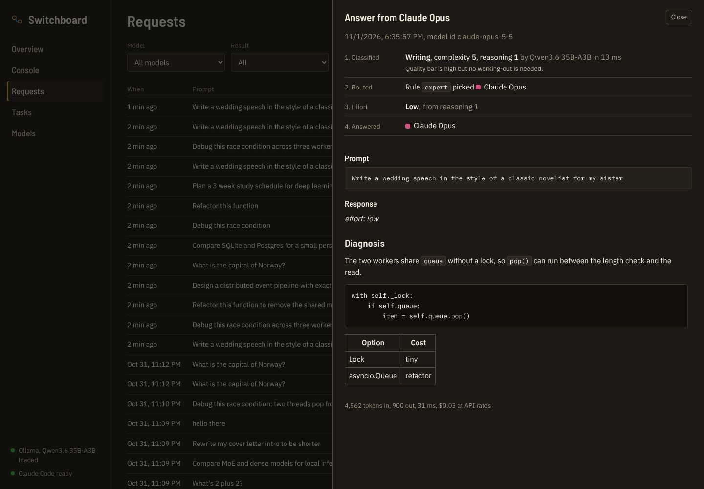

# AI Dashboard (Switchboard)

A local dashboard that routes each prompt to the model best suited to answer it, and keeps track of tokens, cost and tasks along the way.

Easy prompts go to a local model running in Ollama. Hard ones go to Claude through Claude Code's headless mode (`claude -p`), which runs on a Claude Pro or Max login instead of API billing. Every request is logged with how it was classified, which rule picked the model, what it cost in tokens, and what it would have cost at API prices.


## How routing works

1. **Classify.** A local model reads the prompt and rates it on two separate scales from 1 to 5. Complexity is how capable a model has to be. Reasoning is how much step-by-step thinking the answer needs. It also labels the task type (code, writing, math, analysis...). If Ollama is down, a keyword heuristic takes over so routing never blocks.
2. **Pick a model.** Rules in `config.yaml` are checked top to bottom and the first match wins. By default, complexity 5 goes to Claude Opus, 4 goes to Claude Sonnet, and so does a complexity 3 prompt that needs reasoning 5. Everything else stays local.
3. **Pick an effort.** Reasoning maps to an effort level: 1 and 2 are low, 3 is medium, 4 is high, 5 is extra high. Claude gets it through `CLAUDE_CODE_EFFORT_LEVEL`, which overrides your own `/effort` setting for that call only. Local models get thinking off at low and on above it.
4. **Answer, with fallback.** If the chosen model fails (Ollama offline, not logged in to Claude Code, usage limit hit), the router tries the next model in `fallback_order` at the same effort and records why.

Because the model and the effort are picked separately, they combine the way the prompt needs:

| Prompt | Complexity | Reasoning | Runs on |
|---|---|---|---|
| A wedding speech in a famous writer's style | 5 | 1 | Opus at low |
| Design an exactly-once event pipeline | 5 | 5 | Opus at extra high |
| A race condition across three workers | 4 | 5 | Sonnet at extra high |
| Refactor a function to remove shared state | 4 | 4 | Sonnet at high |
| A 3-week study plan | 3 | 3 | Qwen, thinking on |
| The capital of Norway | 1 | 1 | Qwen, thinking off |

Rules can pin the effort (`effort: high`) or clamp it (`min_effort`, `max_effort`), and a Claude model can have its own `max_effort` cap, for example to keep Opus from using too much of your plan. Picking a model or effort in the Console, or with `--model` and `--effort` on the CLI, overrides the router for that prompt.

Two details matter on a single GPU:

- The classifier uses whichever configured local model is already in VRAM, so classifying never triggers a model swap.
- If a rule picks a local model that isn't loaded but another one is, the loaded model answers. Turn this off with `prefer_loaded_local: false`.



## What it tracks

- **Router requests.** Prompt, answer, classification, rule, model, effort, tokens, latency and fallbacks, stored in SQLite.
- **Claude Code usage.** Your own Claude Code sessions are read from `~/.claude/projects/**/*.jsonl` every minute, so the dashboard shows usage by model and day even for work done outside it. Calls the router makes through `claude -p` are tagged separately. Chats on claude.ai don't write local logs, so they can't be counted.
- **Cost at API rates.** A Pro plan isn't billed per token, so costs are shown as what the same usage would cost on the Claude API. Local answers are priced against a reference model (Sonnet by default) to estimate what running locally kept off Claude. Local and Claude tokenizers differ, so treat that one as a ballpark.
- **Tasks.** A simple to do / in progress / done board. Attach prompts to a task to see how many tokens each piece of work takes.

## Requirements

- Windows 10/11 (macOS and Linux work too)
- Python 3.11 or newer
- Node.js 22 LTS (only to build the dashboard)
- [Ollama](https://ollama.com) with at least one model pulled
- [Claude Code](https://code.claude.com), installed and logged in with your Claude account

## Setup on Windows

```powershell
git clone https://github.com/Anders-T-Strand/AI-Dashboard.git
cd AI-Dashboard

# Pull the local models named in config.yaml (or edit config.yaml to match what you have)
ollama pull qwen3.6:35b-a3b

# Make sure Claude Code works headless on your login
claude -p "say hi"

# Start it. The first run sets up Python and builds the dashboard.
.\switchboard
```

The dashboard opens in your browser at http://127.0.0.1:8787. You can also double-click `switchboard.cmd` in Explorer, or make a shortcut to it and pin that to the taskbar.

After the first run it just starts the server. It rebuilds the dashboard on its own when you pull changes.

To start it from any folder, add this to your PowerShell profile (`notepad $PROFILE`) with your own path:

```powershell
function switchboard { & "C:\path\to\AI-Dashboard\switchboard.cmd" @args }
```

If the sidebar says Claude Code wasn't found, run `where.exe claude` in PowerShell. The server also checks `%USERPROFILE%\.local\bin` and `%APPDATA%\npm`, so a fresh install is usually picked up after a restart. Otherwise set `claude.command` in `config.yaml` to the full path of `claude.exe`.

### Manual setup

```powershell
cd backend
py -3 -m venv .venv
.venv\Scripts\activate
pip install -r requirements.txt

cd ..\frontend
npm install
npm run build

cd ..\backend
python -m switchboard
```

## Using it from the terminal

With the server running:

```powershell
cd backend
python -m switchboard ask "Why does my PyTorch DataLoader hang on Windows?"
python -m switchboard ask --model claude-opus "Review this design: ..."
python -m switchboard ask --effort low "Summarize this changelog: ..."
Get-Content notes.txt | python -m switchboard ask -
python -m switchboard ask --task 3 "Draft the intro paragraph"
```

The routing decision and token counts print to stderr and the answer to stdout, so the answer can be piped somewhere else.

## Configuration

Everything lives in `config.yaml`. Restart the server after editing it.

| Section | What it controls |
|---|---|
| `models` | Every model the router can use. `provider` is `ollama` or `claude_cli`. For Claude, `model` is the alias passed to `claude --model` and `max_effort` caps its effort. For Ollama, `think` pins thinking on or off. |
| `routing.rules` | Ordered rules. Conditions: `task_types`, `min_complexity`, `max_complexity`, `min_reasoning`, `max_reasoning`. Effort: `effort` to pin it, `min_effort` and `max_effort` to clamp it. |
| `routing.effort.by_reasoning` | Which effort level each reasoning rating gets. Leave a level out to use your own `/effort` setting for it. |
| `routing.classifier` | Which local model classifies, and whether it may use whatever is already loaded. |
| `routing.fallback_order` | What to try when the chosen model fails. |
| `claude` | CLI path, timeout, tools to block, and `use_subscription`, which strips `ANTHROPIC_API_KEY` from the `claude -p` environment so routed calls use your plan instead of API billing. |
| `pricing` | Per-million-token prices used for the API-rate estimates. |
| `server.host` | Set to your Tailscale IP or `0.0.0.0` to open the dashboard from other devices. There is no login, so only expose it on a private network. |

To send moderate coding work to Claude as well, uncomment the `code` rule in `config.yaml`. If Opus isn't available on your plan in Claude Code, complexity 5 prompts fall back to Sonnet on their own, or point the `expert` rule at `claude-sonnet`.

### A note on Claude usage limits

Routed Claude calls count against the same usage limits as your normal Claude and Claude Code use. `claude -p` is meant for scripting your own work, so this is a personal tool, not a backend to share with other people.

## Development

```powershell
# Backend tests (fake Ollama and a fake claude CLI, no network needed)
cd backend
pip install pytest
python -m pytest

# Dashboard with hot reload. API calls proxy to the Python server on :8787
cd frontend
npm run dev
```

```
backend/switchboard/
  router.py        classifier prompt, heuristic fallback, rule matching, fallback chain
  providers/       Ollama HTTP client and the claude -p runner
  claude_logs.py   incremental reader for Claude Code session logs
  stats.py         aggregations for the dashboard
  service.py       request logging and tasks
  main.py          FastAPI app, serves the built dashboard at /
frontend/src/      React + Vite dashboard
```

## Ideas for later

- Train a router on the logged requests (prompt features in, model that should have answered out) and compare it against the classifier
- Let a request be re-run on a different model from the request log to compare answers
- Thumbs up / down on answers to build labels for that router
